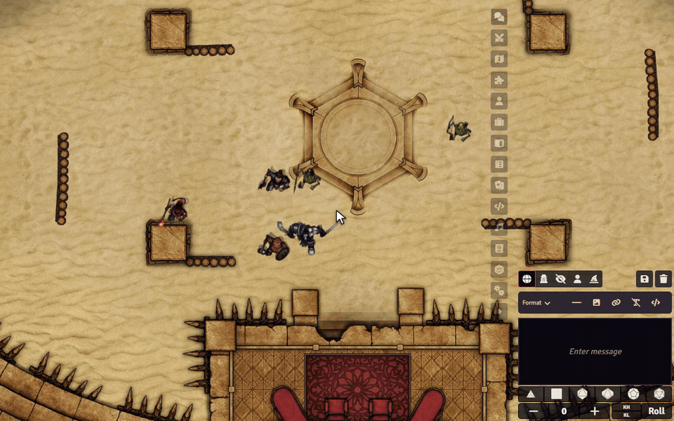

# Sephral’s Campaign Album

**The critical hit that ended the dragon. The last stand at the bridge. The night the bard reached level five. Campaign Album keeps those moments as photos, exactly as your players saw them, and fills a scrapbook of your campaign session by session.**

*The demo uses heroes, adversaries and the arena map of Crucible's playtest adventure.*

## Highlights

* **Photos that take themselves:** critical hits, fallen bosses, victories, farewells, level ups and the sunrise of a new day are captured the moment they happen. A limit per session keeps every photo special.
* **Through your players' eyes:** each photo shows what a player of a character in the picture saw, with their light, their vision and their fog of war. Hidden enemies and secret corners stay hidden.
* **A clean picture:** no selection frames, rulers or wall handles in the photo, and nobody's view jumps around while it is taken.
* **A scrapbook for the whole group:** one page per session in a journal everyone can read, with captions, dates and who was there.
* **Slideshow:** relive the campaign at the end of an evening or before the next one.
* **Players take photos too:** the camera button sends their view to the GM, who adds it with one click, or straight into the album if you like.
* **You stay in charge:** choose the moments, the limit and whose eyes count, edit captions or take photos out at any time.

## How it works

1. Enable the module. The GM's client creates the album on the first start.
2. Play. Great moments land in the album on their own, and the camera button in the token controls takes a photo whenever you want.
3. Open the album from the token controls or the journal directory, browse the sessions or start the slideshow.

## Good to know

A GM has to be online for photos to be stored. The photos are images in your world folder, on The Forge in your Assets Library.

## Install

Use the manifest URL `https://github.com/Sephral/sephrals-campaign-album/releases/latest/download/module.json` in Foundry's module installer.

Foundry VTT 13 and 14 · any game system, built in support for Crucible and D&D 5e · English and German

## Learn more

Settings, the moments per system and the storage are explained in the [manual](MANUAL.md). Questions or ideas? Join us on [Discord](https://discord.gg/7BjCgDYaBP). Looking for more? See [all modules by Sephral](https://github.com/Sephral).

## License

See [LICENSE.md](LICENSE.md).
